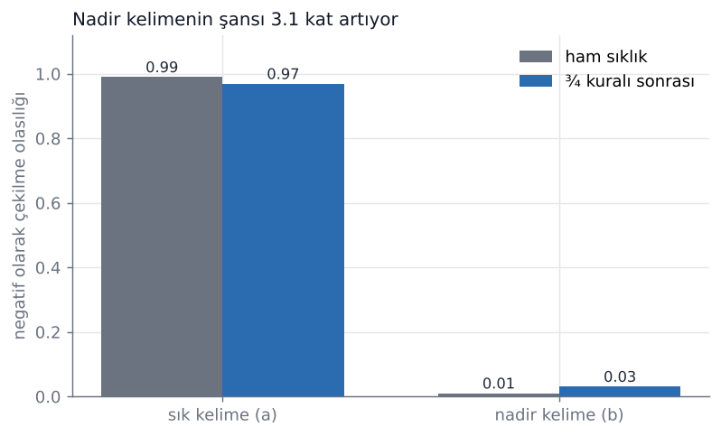
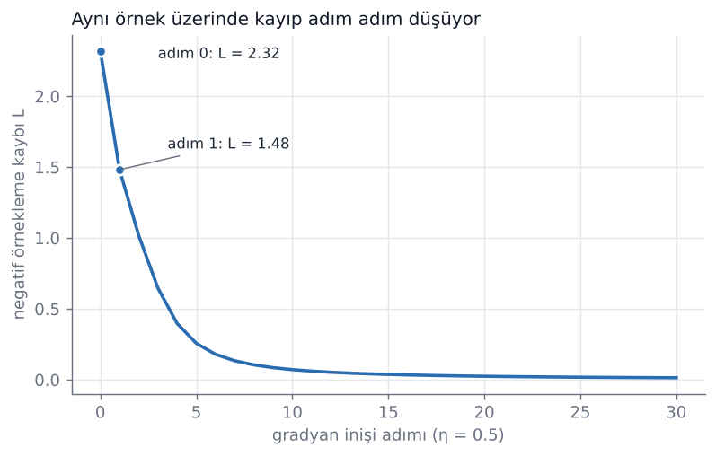
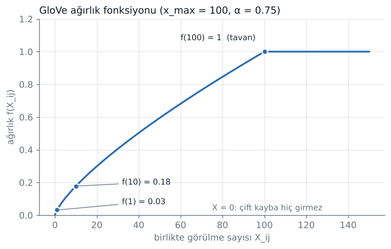
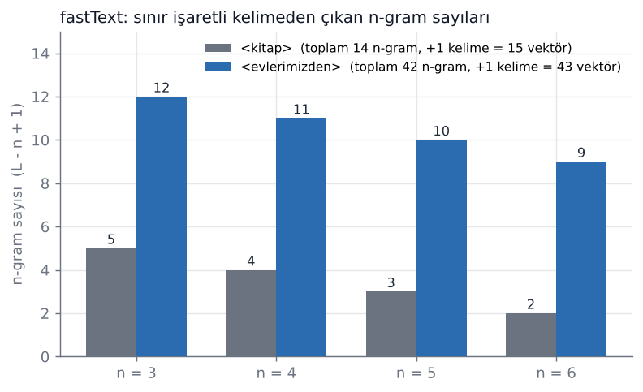
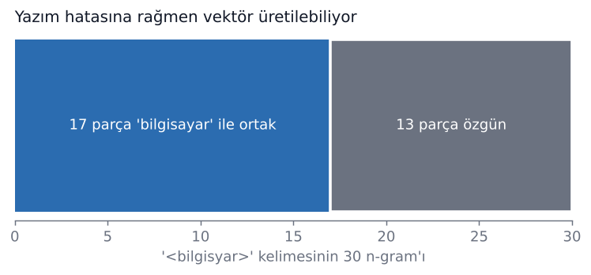

# Kelime Gömmeleri: word2vec, GloVe ve fastText

Türkçe | [English](#word-embeddings-word2vec-glove-and-fasttext)

Üç ünlü kelime gömme yönteminin **sıfırdan, adım adım el hesabıyla** anlatımı ve bu hesapları birebir tekrarlayan Python kodu. Sayılar elle de hesaplanabilecek kadar küçüktür (vektör boyutu 2), böylece formüllerin her parçası görülebilir.

| Yöntem | Fikir |
|---|---|
| **word2vec** | Pencerede bağlamı **tahmin eder** (skip-gram + negatif örnekleme) |
| **GloVe** | Birlikte-görülme sayılarını **sayar**, logaritmasına uydurur |
| **fastText** | word2vec + kelimeyi **karakter n-gram'larının toplamı** olarak görür |

> Kod içindeki değişken ve yorumlar Türkçedir (`kosinus_benzerligi` = cosine similarity, `ngramlar` = n-grams, `adim_at` = take a step...).

## Dosyalar

| Dosya | İçerik |
|---|---|
| [`ortak.py`](ortak.py) | `sigmoid`, `kosinus_benzerligi`, `one_hot` |
| [`word2vec.py`](word2vec.py) | skip-gram çiftleri, softmax, ¾ kuralı, alt örnekleme, negatif örnekleme kaybı, gradyanlar, güncelleme |
| [`word2vec_el_hesabi.py`](word2vec_el_hesabi.py) | word2vec hesabını adım adım ekrana yazar |
| [`glove.py`](glove.py) | birlikte-görülme matrisi, `P(j\|i)`, olasılık oranı, ağırlık `f`, kayıp |
| [`glove_el_hesabi.py`](glove_el_hesabi.py) | GloVe hesabını adım adım ekrana yazar |
| [`fasttext.py`](fasttext.py) | n-gram çıkarma, kelime vektörü, FNV-1a hash kovaları, ortak n-gram |
| [`fasttext_el_hesabi.py`](fasttext_el_hesabi.py) | fastText hesabını adım adım ekrana yazar |
| [`gorseller_uret.py`](gorseller_uret.py) | `gorseller/` altındaki PNG'leri üretir |
| [`test_el_hesaplari.py`](test_el_hesaplari.py) | README'deki sayıların kodla tuttuğunu denetler |

## Çalıştırma

```bash
pip install -r requirements.txt

python word2vec_el_hesabi.py
python glove_el_hesabi.py
python fasttext_el_hesabi.py

python gorseller_uret.py      # görselleri yeniden üretir
python test_el_hesaplari.py   # ya da: pytest
```

Bu README'deki bütün sayılar yukarıdaki scriptlerin çıktısıdır. `gensim` kuruluysa test dosyası fastText n-gram ve hash değerlerini gensim ile de karşılaştırır (zorunlu değil).

---

## 1. Neden gömme? One-hot'un sorunu

**One-hot:** Sözlükte `V` kelime varsa her kelime `V` uzunluğunda, tek yerinde 1, geri kalanı 0 olan bir vektördür.

```
kedi  -> [1, 0, 0, 0, 0]
köpek -> [0, 1, 0, 0, 0]
masa  -> [0, 0, 1, 0, 0]
```

Farklı iki one-hot vektörün iç çarpımı hep 0'dır (1'ler hiçbir zaman aynı konuma gelmez):

```
kedi · köpek = 1·0 + 0·1 + 0·0 + 0·0 + 0·0 = 0
kedi · masa  = 0
```

Yani model için "kedi"–"köpek" mesafesi ile "kedi"–"masa" mesafesi aynıdır; benzerlik bilgisi yoktur. 477 bin kelimelik bir sözlükte her vektör 477 bin sayıdır (çoğu sıfır).

**Dağılımsal hipotez:** *Aynı bağlamlarda geçen kelimelerin anlamı benzerdir.* Bu yüzden her kelimeye kısa (100–300 boyut), yoğun, **derlemden öğrenilen** bir vektör verilir. Üç yöntem de bunu farklı yollarla yapar.

---

## 2. word2vec (skip-gram + negatif örnekleme)

Dosyalar: [`word2vec.py`](word2vec.py), [`word2vec_el_hesabi.py`](word2vec_el_hesabi.py)

### 2.1 Skip-gram çiftleri

Her kelime merkez alınır, solundaki ve sağındaki `pencere` kadar komşusu bağlam olur. Cümle `sabah sıcak çay içtim`, pencere = 1:

```
(sabah, sıcak)
(sıcak, sabah)  (sıcak, çay)
(çay, sıcak)    (çay, içtim)
(içtim, çay)
```

Toplam **6 çift**. Kısa yol: `n` kelime ve pencere 1 için `2(n−1) = 2·3 = 6`. Uçtaki kelimelerin tek komşusu vardır; "8" bulmak sık yapılan hatadır.

### 2.2 Softmax neden pahalı?

```
P(w_t | bağlam) = exp(y_wt) / Σ_{i=1..|V|} exp(y_i)
```

Payda, sözlükteki **her** kelimenin skorunu ister:

| | Çarpma sayısı |
|---|---|
| Tam softmax (`\|V\|=300.000`, `d=300`) | 300.000 × 300 = **90.000.000** |
| Negatif örnekleme (1 pozitif + `k=5` negatif) | 6 × 300 = **1.800** |
| Oran | 90.000.000 / 1.800 = **50.000 kat** |

Çözüm: "Hangi kelime gelir?" sorusunu "**Bu çift gerçekten metinde geçti mi?**" evet/hayır sorusuna çevirmek.

- Gerçek çift (`çay`, `içtim`) için `σ(c·w) → 1`
- Uydurma çiftler (`çay`, `masa`), (`çay`, `koştu`) için `σ(c·w) → 0`

Her kelimenin **iki** vektörü vardır: merkez olarak `w`, bağlam olarak `c`. (Tek vektör olsaydı `w·w` hep büyük çıkardı, yani kelime kendi yanında beklenirdi.)

### 2.3 Negatifleri çekmek: ¾ kuralı

Negatifler ham sıklıkla değil, sıklığın **¾ kuvvetiyle** çekilir:

```
P(w) = f(w)^0.75 / Σ f(v)^0.75
```

İki kelimelik örnek, `a = 0.99`, `b = 0.01`:

```
a^0.75 = 0.9925      b^0.75 = 0.0316      toplam = 1.0241
a = 0.9925 / 1.0241 = 0.97     (0.99'dan biraz azaldı)
b = 0.0316 / 1.0241 = 0.03     (0.01'den yaklaşık 3 kat arttı)
```



**Alt örnekleme** ayrı bir hiledir: çok sık kelimeler (`bir`, `ve`, `bu`) eğitim metninden rastgele **atlanır** (çünkü (`çay`, `ve`) çifti `çay` hakkında bilgi taşımaz). Atılma olasılığı `1 − sqrt(t/f)`, `t = 10⁻⁵`:

| Sıklık `f` | Atılma olasılığı |
|---|---|
| 0.01 (çok sık) | 0.968 |
| 0.0001 | 0.684 |
| 10⁻⁶ (nadir) | 0 |

¾ kuralı negatif **çekerken**, alt örnekleme metinden kelime **atlarken** uygulanır.

### 2.4 Negatif örnekleme kaybı (elle hesap)

```
L = −[ log σ(c_poz · w) + Σ_neg log σ(−c_neg · w) ]
```

Kurulum (boyut 2):

| Rol | Kelime | Vektör |
|---|---|---|
| Merkez `w` | çay | (1, 1) |
| Pozitif bağlam | içtim | (0.5, −0.5) |
| Negatif 1 | masa | (0.5, 0.5) |
| Negatif 2 | koştu | (−1, 0) |

| Terim | `c·w` | `σ(±c·w)` | Ceza `= −log σ` |
|---|---|---|---|
| içtim (pozitif) | 0 | σ(0) = 0.5000 | **0.6931** |
| masa (negatif) | 1 | σ(−1) = 0.2689 | **1.3133** |
| koştu (negatif) | −1 | σ(+1) = 0.7311 | **0.3133** |

**L = 0.6931 + 1.3133 + 0.3133 ≈ 2.32**

Negatiflerde işaret ters çevrilir: `masa` için `c·w = 1` olduğundan model uydurma çifti "gerçek" sanıyor ve ağır ceza yiyor. `koştu` için `c·w = −1`, ceza küçük.

### 2.5 Gradyanlar ve güncelleme

```
dL/dc_poz = (σ(c_poz·w) − 1) · w
dL/dc_neg = σ(c_neg·w) · w
dL/dw     = (σ(c_poz·w) − 1) · c_poz + Σ σ(c_neg·w) · c_neg
```

Sayılarla:

```
dL/dc_içtim = (0.5 − 1)·(1,1)     = (−0.5, −0.5)
dL/dc_masa  = 0.7311·(1,1)        = ( 0.7311,  0.7311)
dL/dc_koştu = 0.2689·(1,1)        = ( 0.2689,  0.2689)
dL/dw       = (−0.25, 0.25) + (0.3655, 0.3655) + (−0.2689, 0) = (−0.1534, 0.6155)
```

Güncelleme `θ ← θ − η·gradyan`, `η = 0.5` (gradyanların hepsi **eski** vektörlerle hesaplanır):

| Vektör | Önce | Sonra |
|---|---|---|
| `w` (çay) | (1, 1) | (1.0767, 0.6922) |
| `c` içtim | (0.5, −0.5) | (0.75, −0.25) |
| `c` masa | (0.5, 0.5) | (0.1345, 0.1345) |
| `c` koştu | (−1, 0) | (−1.1345, −0.1345) |

| Skor `c·w` | Önce | Sonra |
|---|---|---|
| çay · içtim | 0.00 | **0.63** (yaklaştı) |
| çay · masa | 1.00 | **0.24** (uzaklaştı) |
| çay · koştu | −1.00 | −1.31 (uzaklaştı) |

**Kayıp 2.32 → 1.48.** Aynı adımı tekrarlarsak:

| Adım | 0 | 1 | 2 | 5 | 10 | 20 | 30 |
|---|---|---|---|---|---|---|---|
| L | 2.3197 | 1.4825 | 1.0179 | 0.2570 | 0.0714 | 0.0246 | 0.0141 |



---

## 3. GloVe

Dosyalar: [`glove.py`](glove.py), [`glove_el_hesabi.py`](glove_el_hesabi.py)

word2vec metni pencerelerle gezip tahmin eder. GloVe önce bütün derlemde **kim kiminle kaç kez yan yana geçmiş sayar**, sonra vektörleri bu sayılara uydurur.

### 3.1 Sayım tablosu

- `X(i, j)`: `j` kelimesi `i`'nin penceresinde kaç kez geçti
- `X(i)`: `i` satırının toplamı
- `P(j | i) = X(i, j) / X(i)`  (MLE: sayım / toplam)

Derlem (pencere = 1):

```
sabah sıcak çay içtim
akşam sıcak kahve içtim
sıcak çay içtim
```

| | akşam | içtim | kahve | sabah | sıcak | çay | X(i) |
|---|---|---|---|---|---|---|---|
| **akşam** | 0 | 0 | 0 | 0 | 1 | 0 | 1 |
| **içtim** | 0 | 0 | 1 | 0 | 0 | 2 | 3 |
| **kahve** | 0 | 1 | 0 | 0 | 1 | 0 | 2 |
| **sabah** | 0 | 0 | 0 | 0 | 1 | 0 | 1 |
| **sıcak** | 1 | 0 | 1 | 1 | 0 | 2 | 5 |
| **çay** | 0 | 2 | 0 | 0 | 2 | 0 | 4 |

```
P(içtim | çay) = 2 / 4 = 0.500
P(sıcak | çay) = 2 / 4 = 0.500
```

### 3.2 Ham olasılık değil, **oran**

`water` hem buzla hem buharla sık geçer; ham olasılığa bakınca ayırt edici görünmez. **Oran** ortak etkiyi sadeleştirir. GloVe makalesindeki `ice` / `steam` örneği, `P(k | ice) / P(k | steam)`:

| `k` | Oran | Yorum |
|---|---|---|
| solid (katı) | 8.9 | büyük: buza özgü |
| gas (gaz) | 0.085 | küçük: buhara özgü |
| water (su) | 1.36 | ≈ 1: ikisiyle de ilgili |
| fashion (moda) | 0.96 | ≈ 1: ikisiyle de ilgisiz |

Kayıp fonksiyonu bu sezgiyi şuna çevirir: iki vektörün iç çarpımı, birlikte görülme sayısının logaritmasına yaklaşsın.

### 3.3 Kayıp fonksiyonu

```
J = Σ f(X_ij) · ( w_iᵀ w̃_j + b_i + b̃_j − log X_ij )²
```

- `w_i`, `w̃_j`: iki ayrı vektör (word2vec'teki `w` ve `c` gibi)
- `b_i`, `b̃_j`: yanlılık terimleri
- `log X_ij`: hedef
- `f(X_ij)`: çiftin ağırlığı

**Tek çift, elle hesap:** `X_ij = 100`, modelin tahmini `w_iᵀw̃_j + b_i + b̃_j = 4.2`

```
Hedef   : ln 100            = 4.6052
Fark    : 4.2 − 4.6052      = −0.4052
Fark²   :                     0.1642
f(100)  :                     1
Kayıp   : 1 × 0.1642        = 0.1642
```

Skorun vektörlerden nasıl çıktığı (örnek değerler):

```
w_i = (1.0, 0.5)   w̃_j = (0.8, 1.2)   b_i = 0.3   b̃_j = −0.1
w_i·w̃_j = 1.0·0.8 + 0.5·1.2 = 1.40
skor    = 1.40 + 0.3 + (−0.1) = 1.60
```

### 3.4 Ağırlık fonksiyonu `f`

```
f(x) = (x / x_max)^α   x < x_max ise       x_max = 100, α = 0.75
     = 1               aksi halde
```

| `x` | 0 | 1 | 10 | 50 | 100 | 1000 |
|---|---|---|---|---|---|---|
| `f(x)` | 0 | 0.0316 | 0.1778 | 0.5946 | 1 | 1 |

- **`X = 0`:** `log 0` tanımsız, bu çift toplamdan **atlanır**.
- **Çok sık çiftler:** ağırlığı 1'de sabitlenir; eğitimi domine etmesinler.
- Arası: ağırlık yavaş yavaş artar; nadir çiftler az, sık çiftler tam katkı verir.



### 3.5 Birkaç çiftten toplam kayıp

Dördüncü çiftte `X = 0` olduğundan atlanır:

| Çift | `X_ij` | tahmin | `log X_ij` | fark² | `f` | `f·fark²` |
|---|---|---|---|---|---|---|
| (çay, sıcak) | 100 | 4.20 | 4.6052 | 0.1642 | 1.0000 | 0.1642 |
| (çay, içtim) | 10 | 2.00 | 2.3026 | 0.0916 | 0.1778 | 0.0163 |
| (çay, akşam) | 1 | 0.50 | 0.0000 | 0.2500 | 0.0316 | 0.0079 |
| (çay, kahve) | 0 | 1.00 | tanımsız | – | – | **atlandı** |

**J = 0.1642 + 0.0163 + 0.0079 = 0.1884**

### 3.6 word2vec ile fark

| | word2vec (SGNS) | GloVe |
|---|---|---|
| Yaklaşım | Pencere pencere tahmin | Küresel sayım tablosu |
| Hedef | Gerçek çiftte `σ(c·w) → 1`, uydurmada `→ 0` | `w·w̃ + b + b̃ ≈ log X_ij` |
| Kayıp türü | log-sigmoid cezaları | Ağırlıklı kare hata |
| Görülmemiş çift | Negatif olarak çekilebilir | Atlanır |

---

## 4. fastText

Dosyalar: [`fasttext.py`](fasttext.py), [`fasttext_el_hesabi.py`](fasttext_el_hesabi.py)

word2vec ve GloVe'da her kelime biçimi ayrı bir kelimedir. Türkçede bir kökten yüzlerce biçim türer (`ev`, `evler`, `evim`, `evlerimizden`...). Nadir biçimlerin vektörü zayıf kalır ve hiç görülmemiş biçim için vektör yoktur (word2vec'te `KeyError`).

**Ana fikir:** kelimeyi karakter n-gram'larına böl, her n-gram'ın kendi vektörü olsun, **kelime vektörü bunların toplamı** olsun.

### 4.1 n-gram çıkarma

1. Kelimenin başına `<`, sonuna `>` konur (`<ev` kelime başındaki "ev"dir, `ev>` sondaki).
2. `n = 3, 4, 5, 6` için tüm kesitler alınır. Uzunluğu `L` olan dizide n-gram sayısı **`L − n + 1`**.
3. Kelimenin kendisi de ayrı bir vektör olarak eklenir.
4. Hepsi toplanır.

`<kitap>` 7 karakter:

| n | 7 − n + 1 |
|---|---|
| 3 | 5 |
| 4 | 4 |
| 5 | 3 |
| 6 | 2 |
| **Toplam** | **14 n-gram + kelimenin kendisi = 15 vektör** |

`<evlerimizden>` 14 karakter: 12 + 11 + 10 + 9 = **42 n-gram + 1 = 43 vektör**. Yalnızca `n = 3` alınırsa:

```
<ev, evl, vle, ler, eri, rim, imi, miz, izd, zde, den, en>     -> 12 tane
```



### 4.2 Küçük sayısal örnek (boyut 2, yalnızca n = 3)

`<ev>` 4 karakter, 3-gramlar `<ev` ve `ev>` (4 − 3 + 1 = 2 tane), kelimenin kendisiyle 3 vektör:

| Parça | Vektör (örnek) |
|---|---|
| `<ev` | (1, 0) |
| `ev>` | (0, 1) |
| `<ev>` (kelime) | (1, 1) |

```
Kelime vektörü = (1, 0) + (0, 1) + (1, 1) = (2, 2)
```

**Paylaşım:** `<evim>` kelimesinin 3-gramları `<ev, evi, vim, im>`. `<ev` parçası `ev` ile ortaktır; `ev` çok sık geçtiği için bu parça iyi öğrenilmiştir ve nadir biçimler bundan yararlanır.

### 4.3 Eğitim ve hash kovaları

Eğitim yine **negatif örneklemeli skip-gram**'dır, kayıp aynıdır. Tek fark: merkez kelimenin `w` vektörü bir tablo satırı değil, n-gram vektörlerinin toplamıdır; gradyan geri yayılınca n-gram vektörleri güncellenir.

n-gram sayısı çok fazla olduğu için her birine ayrı satır tutulmaz; **2 milyon kovalı** bir hash tablosu kullanılır (FNV-1a). Farklı n-gram'lar aynı kovaya düşebilir, çakışma kabul edilir.

```
kova('<ev') = 232484     kova('ev>') = 1899156     kova('evl') = 780106
```

### 4.4 Hiç görülmemiş kelime / yazım hatası (OOV)

`bilgisyar` (yanlış yazım) sözlükte yok. word2vec `KeyError` verir; fastText n-gram'larından vektör üretir:

```
<bilgisyar> : 30 n-gram
<bilgisayar>: 34 n-gram
Ortak n-gram: 17   (30 parçanın 17'si 'bilgisayar' ile ortak)
```



Gösterim için rastgele (sabit tohumlu) n-gram vektörleriyle: `cos(bilgisyar, bilgisayar) = 0.544`, `cos(bilgisyar, masa) = 0.213`. Gerçek eğitimde n-gram vektörleri derlemden öğrenilmiş olur; buradaki rastgele vektörler yalnızca ortak parçaların benzerliği nasıl yükselttiğini göstermek içindir.

### 4.5 Neden özellikle Türkçede işe yarıyor?

Eklemeli dillerde ekler (`-ler`, `-imiz`, `-den`) hem çok sık hem anlamlı parçalardır. n-gram'lar bunları, kök-ek ayrımını bilmeden kendiliğinden yakalar. Kazanç en çok **eklemeli dillerde** ve **nadir kelimelerde** görülür.

---

## 5. Üç yöntemin özeti

| | word2vec | GloVe | fastText |
|---|---|---|---|
| Nasıl öğrenir? | Pencerede tahmin eder (negatif örnekleme) | Birlikte-görülme sayısının logaritmasına uydurur | word2vec + n-gram toplamı |
| Kelime vektörü | Tek tablo satırı | Tek tablo satırı | n-gram vektörlerinin toplamı |
| Görülmemiş kelime | `KeyError` | Vektör yok | n-gram'lardan vektör üretir |
| Eklemeli dillerde | Nadir biçimler zayıf | Nadir biçimler zayıf | Parça paylaşımıyla güçlü |

Üçü de **statik** gömmedir: kelime başına tek vektör verir, bağlama göre değişmez.

## Notlar

- `gensim` varsayılanı CBOW'dur (`sg=0`); skip-gram için `sg=1` gerekir. gensim fastText'te toplam yerine **ortalama** alır; kosinüs benzerliği vektör uzunluğundan etkilenmediği için fark etmez.
- Kosinüs benzerliği vektörün **yönüne** bakar, iç çarpım uzunluktan da etkilenir.
- Dağılımsal yöntemler zıt anlamlıları (sıcak–soğuk) ayıramaz: ikisi de aynı bağlamlarda geçer. Benzerlik ile ilişkililik de ayrı kavramlardır (kahve–fincan ilişkili ama benzer değil).
- Bu depo öğretici amaçlıdır; gerçek derlemlerde eğitim için `gensim` veya resmî `fastText` kullanılmalıdır.

---

<details>
<summary><b>English version (click to expand)</b></summary>

# Word Embeddings: word2vec, GloVe and fastText

A **from-scratch, step-by-step hand calculation** of three well-known word embedding methods, plus Python code that reproduces every number. The examples are tiny (vector size 2) so each part of every formula can be followed by hand.

| Method | Idea |
|---|---|
| **word2vec** | **Predicts** context words inside a window (skip-gram + negative sampling) |
| **GloVe** | **Counts** co-occurrences and fits vectors to their logarithm |
| **fastText** | word2vec + a word is the **sum of its character n-gram vectors** |

> Note: identifiers and comments in the code are in Turkish (e.g. `kosinus_benzerligi` = cosine similarity, `ngramlar` = n-grams, `adim_at` = take a step, `kayip` = loss, `agirlik` = weight).

## Files

| File | Contents |
|---|---|
| [`ortak.py`](ortak.py) | `sigmoid`, cosine similarity, one-hot |
| [`word2vec.py`](word2vec.py) | skip-gram pairs, softmax, ¾ rule, subsampling, negative-sampling loss, gradients, update step |
| [`word2vec_el_hesabi.py`](word2vec_el_hesabi.py) | prints the word2vec hand calculation step by step |
| [`glove.py`](glove.py) | co-occurrence matrix, `P(j\|i)`, probability ratio, weight `f`, loss |
| [`glove_el_hesabi.py`](glove_el_hesabi.py) | prints the GloVe hand calculation |
| [`fasttext.py`](fasttext.py) | n-gram extraction, word vector, FNV-1a hash buckets, shared n-grams |
| [`fasttext_el_hesabi.py`](fasttext_el_hesabi.py) | prints the fastText hand calculation |
| [`gorseller_uret.py`](gorseller_uret.py) | generates the PNGs under `gorseller/` |
| [`test_el_hesaplari.py`](test_el_hesaplari.py) | checks that the numbers below match the code |

## Run it

```bash
pip install -r requirements.txt

python word2vec_el_hesabi.py
python glove_el_hesabi.py
python fasttext_el_hesabi.py

python gorseller_uret.py      # regenerate the figures
python test_el_hesaplari.py   # or: pytest
```

Every number in this README is the output of these scripts. If `gensim` is installed, the tests also cross-check fastText n-grams and hash buckets against gensim (optional).

---

## 1. Why embeddings? The one-hot problem

A one-hot vector has the vocabulary size, with a single 1 and zeros elsewhere:

```
cat   -> [1, 0, 0, 0, 0]
dog   -> [0, 1, 0, 0, 0]
table -> [0, 0, 1, 0, 0]
```

The dot product of two different one-hot vectors is always 0, so "cat"–"dog" is exactly as far apart as "cat"–"table": no notion of similarity. With a vocabulary of 477k words each vector has 477k entries.

**Distributional hypothesis:** *words that occur in similar contexts have similar meanings.* So every word gets a short (100–300 dims), dense vector **learned from a corpus**. The three methods learn it in different ways.

---

## 2. word2vec (skip-gram + negative sampling)

### 2.1 Skip-gram pairs

Each word is the center; its neighbours within the window are the context. Sentence `sabah sıcak çay içtim` ("had hot tea in the morning"), window = 1:

```
(sabah, sıcak)
(sıcak, sabah)  (sıcak, çay)
(çay, sıcak)    (çay, içtim)
(içtim, çay)
```

**6 pairs** in total. Shortcut for `n` words and window 1: `2(n−1) = 6`.

### 2.2 Why is softmax expensive?

```
P(w_t | context) = exp(y_wt) / Σ_{i=1..|V|} exp(y_i)
```

The denominator needs the score of **every** word:

| | Multiplications |
|---|---|
| Full softmax (`\|V\|=300,000`, `d=300`) | 300,000 × 300 = **90,000,000** |
| Negative sampling (1 positive + `k=5` negatives) | 6 × 300 = **1,800** |
| Ratio | **50,000×** |

Fix: turn "which word comes next?" into the yes/no question "**did this pair really occur?**"

- real pair (`çay`, `içtim`): `σ(c·w) → 1`
- fake pairs (`çay`, `masa`), (`çay`, `koştu`): `σ(c·w) → 0`

Each word has **two** vectors: `w` as a center word and `c` as a context word.

### 2.3 Drawing negatives: the ¾ rule

Negatives are drawn from the frequency raised to the power **¾**:

```
P(w) = f(w)^0.75 / Σ f(v)^0.75
```

Two words, `a = 0.99`, `b = 0.01`:

```
a^0.75 = 0.9925      b^0.75 = 0.0316      sum = 1.0241
a = 0.97   (down slightly)       b = 0.03   (about 3× up)
```


**Subsampling** is a separate trick: very frequent words are randomly **dropped** from the training text. Discard probability `1 − sqrt(t/f)` with `t = 10⁻⁵`: 0.968 for `f = 0.01`, 0.684 for `f = 10⁻⁴`, 0 for `f = 10⁻⁶`. The ¾ rule applies when **drawing negatives**; subsampling applies when **reading the text**.

### 2.4 Negative-sampling loss (hand calculation)

```
L = −[ log σ(c_pos · w) + Σ_neg log σ(−c_neg · w) ]
```

| Role | Word | Vector |
|---|---|---|
| Center `w` | çay (tea) | (1, 1) |
| Positive context | içtim (drank) | (0.5, −0.5) |
| Negative 1 | masa (table) | (0.5, 0.5) |
| Negative 2 | koştu (ran) | (−1, 0) |

| Term | `c·w` | `σ(±c·w)` | Penalty `= −log σ` |
|---|---|---|---|
| içtim (positive) | 0 | σ(0) = 0.5000 | **0.6931** |
| masa (negative) | 1 | σ(−1) = 0.2689 | **1.3133** |
| koştu (negative) | −1 | σ(+1) = 0.7311 | **0.3133** |

**L = 0.6931 + 1.3133 + 0.3133 ≈ 2.32**

For negatives the sign flips: `masa` has `c·w = 1`, so the model thinks the fake pair is real and is penalised heavily.

### 2.5 Gradients and one update step

```
dL/dc_pos = (σ(c_pos·w) − 1) · w
dL/dc_neg = σ(c_neg·w) · w
dL/dw     = (σ(c_pos·w) − 1) · c_pos + Σ σ(c_neg·w) · c_neg
```

```
dL/dc_içtim = (−0.5, −0.5)
dL/dc_masa  = (0.7311, 0.7311)
dL/dc_koştu = (0.2689, 0.2689)
dL/dw       = (−0.25, 0.25) + (0.3655, 0.3655) + (−0.2689, 0) = (−0.1534, 0.6155)
```

Update `θ ← θ − η·gradient`, `η = 0.5` (all gradients use the **old** vectors):

| Vector | Before | After |
|---|---|---|
| `w` (çay) | (1, 1) | (1.0767, 0.6922) |
| `c` içtim | (0.5, −0.5) | (0.75, −0.25) |
| `c` masa | (0.5, 0.5) | (0.1345, 0.1345) |
| `c` koştu | (−1, 0) | (−1.1345, −0.1345) |

Scores `c·w`: çay·içtim **0.00 → 0.63**, çay·masa **1.00 → 0.24**, çay·koştu −1.00 → −1.31. **Loss 2.32 → 1.48.** Repeating the step:

| Step | 0 | 1 | 2 | 5 | 10 | 20 | 30 |
|---|---|---|---|---|---|---|---|
| L | 2.3197 | 1.4825 | 1.0179 | 0.2570 | 0.0714 | 0.0246 | 0.0141 |


---

## 3. GloVe

word2vec scans the text and predicts. GloVe first **counts how often each pair of words co-occurs** over the whole corpus, then fits vectors to those counts.

### 3.1 Count table

- `X(i, j)`: how many times `j` appears in `i`'s window
- `X(i)`: row sum
- `P(j | i) = X(i, j) / X(i)`

Corpus (window = 1):

```
sabah sıcak çay içtim
akşam sıcak kahve içtim
sıcak çay içtim
```

| | akşam | içtim | kahve | sabah | sıcak | çay | X(i) |
|---|---|---|---|---|---|---|---|
| **akşam** | 0 | 0 | 0 | 0 | 1 | 0 | 1 |
| **içtim** | 0 | 0 | 1 | 0 | 0 | 2 | 3 |
| **kahve** | 0 | 1 | 0 | 0 | 1 | 0 | 2 |
| **sabah** | 0 | 0 | 0 | 0 | 1 | 0 | 1 |
| **sıcak** | 1 | 0 | 1 | 1 | 0 | 2 | 5 |
| **çay** | 0 | 2 | 0 | 0 | 2 | 0 | 4 |

`P(içtim | çay) = 2/4 = 0.500`, `P(sıcak | çay) = 2/4 = 0.500`.

### 3.2 Ratios, not raw probabilities

`water` co-occurs often with both ice and steam, so its raw probability is not discriminative. The **ratio** cancels shared effects. From the GloVe paper, `P(k | ice) / P(k | steam)`:

| `k` | Ratio | Meaning |
|---|---|---|
| solid | 8.9 | large: specific to ice |
| gas | 0.085 | small: specific to steam |
| water | 1.36 | ≈ 1: related to both |
| fashion | 0.96 | ≈ 1: related to neither |

### 3.3 Loss

```
J = Σ f(X_ij) · ( w_iᵀ w̃_j + b_i + b̃_j − log X_ij )²
```

**One pair:** `X_ij = 100`, model output `4.2`:

```
target : ln 100        = 4.6052
diff   : 4.2 − 4.6052  = −0.4052
diff²  :                 0.1642
f(100) :                 1
loss   : 1 × 0.1642    = 0.1642
```

Where the output comes from (example values): `w_i = (1.0, 0.5)`, `w̃_j = (0.8, 1.2)`, `b_i = 0.3`, `b̃_j = −0.1` give `1.0·0.8 + 0.5·1.2 + 0.3 − 0.1 = 1.60`.

### 3.4 Weight function `f`

```
f(x) = (x / x_max)^α  if x < x_max        x_max = 100, α = 0.75
     = 1              otherwise
```

| `x` | 0 | 1 | 10 | 50 | 100 | 1000 |
|---|---|---|---|---|---|---|
| `f(x)` | 0 | 0.0316 | 0.1778 | 0.5946 | 1 | 1 |

- **`X = 0`:** `log 0` is undefined, so the pair is **skipped**.
- **Very frequent pairs:** weight is capped at 1 so they do not dominate training.


### 3.5 Total loss over a few pairs

| Pair | `X_ij` | output | `log X_ij` | diff² | `f` | `f·diff²` |
|---|---|---|---|---|---|---|
| (çay, sıcak) | 100 | 4.20 | 4.6052 | 0.1642 | 1.0000 | 0.1642 |
| (çay, içtim) | 10 | 2.00 | 2.3026 | 0.0916 | 0.1778 | 0.0163 |
| (çay, akşam) | 1 | 0.50 | 0.0000 | 0.2500 | 0.0316 | 0.0079 |
| (çay, kahve) | 0 | 1.00 | undefined | – | – | **skipped** |

**J = 0.1884**

### 3.6 word2vec vs GloVe

| | word2vec (SGNS) | GloVe |
|---|---|---|
| Approach | Predict, window by window | Global count table |
| Target | real pair `σ(c·w) → 1`, fake `→ 0` | `w·w̃ + b + b̃ ≈ log X_ij` |
| Loss | log-sigmoid penalties | weighted squared error |
| Unseen pair | can still be drawn as a negative | skipped |

---

## 4. fastText

In word2vec and GloVe every word form is a separate word. In Turkish one stem yields hundreds of forms (`ev`, `evler`, `evim`, `evlerimizden`...), so rare forms get weak vectors and unseen forms get none (`KeyError` in word2vec).

**Main idea:** split the word into character n-grams, give each n-gram its own vector, and let the **word vector be their sum**.

### 4.1 Extracting n-grams

1. Add `<` at the start and `>` at the end.
2. For `n = 3..6` take all substrings. A string of length `L` has **`L − n + 1`** n-grams.
3. The word itself is added as its own vector.
4. Sum everything.

`<kitap>` has 7 characters: 5 + 4 + 3 + 2 = **14 n-grams + the word itself = 15 vectors**.
`<evlerimizden>` has 14 characters: 12 + 11 + 10 + 9 = **42 + 1 = 43 vectors**. With `n = 3` only:

```
<ev, evl, vle, ler, eri, rim, imi, miz, izd, zde, den, en>     -> 12
```


### 4.2 Tiny numeric example (size 2, `n = 3` only)

`<ev>` has 4 characters → 3-grams `<ev`, `ev>` (4 − 3 + 1 = 2) plus the word = 3 vectors:

| Piece | Vector (example) |
|---|---|
| `<ev` | (1, 0) |
| `ev>` | (0, 1) |
| `<ev>` (word) | (1, 1) |

```
word vector = (1, 0) + (0, 1) + (1, 1) = (2, 2)
```

**Sharing:** the 3-grams of `<evim>` are `<ev, evi, vim, im>`. The piece `<ev` is shared with `ev`, which is very frequent, so that piece is well learned and rare forms benefit from it.

### 4.3 Training and hash buckets

Training is still **skip-gram with negative sampling** with the same loss. The only difference: the center vector `w` is the sum of n-gram vectors instead of a table row; the gradient flows back to the n-gram vectors.

Because there are so many n-grams, they are mapped to **2 million buckets** with a hash (FNV-1a). Collisions are accepted.

```
bucket('<ev') = 232484     bucket('ev>') = 1899156     bucket('evl') = 780106
```

### 4.4 Unseen words / typos (OOV)

`bilgisyar` (a typo of `bilgisayar`, "computer") is not in the vocabulary. word2vec raises `KeyError`; fastText builds a vector from its n-grams:

```
<bilgisyar> : 30 n-grams
<bilgisayar>: 34 n-grams
shared      : 17   (17 of the 30 pieces also occur in 'bilgisayar')
```


With random (fixed-seed) n-gram vectors for illustration: `cos(bilgisyar, bilgisayar) = 0.544`, `cos(bilgisyar, masa) = 0.213`. In real training the n-gram vectors are learned from a corpus; the random ones here only show how shared pieces raise similarity.

### 4.5 Why it helps in Turkish

In agglutinative languages suffixes (`-ler`, `-imiz`, `-den`) are both frequent and meaningful. n-grams capture them automatically without knowing the stem/suffix split. The gain is largest for **agglutinative languages** and **rare words**.

---

## 5. Summary

| | word2vec | GloVe | fastText |
|---|---|---|---|
| Learns by | predicting in a window (negative sampling) | fitting `log` co-occurrence counts | word2vec + n-gram sum |
| Word vector | one table row | one table row | sum of n-gram vectors |
| Unseen word | `KeyError` | no vector | builds one from n-grams |
| Agglutinative languages | weak for rare forms | weak for rare forms | strong via shared pieces |

All three are **static** embeddings: one vector per word, regardless of context.

## Notes

- `gensim` defaults to CBOW (`sg=0`); use `sg=1` for skip-gram. gensim's fastText takes the **mean** instead of the sum; cosine similarity ignores vector length, so it makes no difference.
- Cosine similarity looks at **direction**; the dot product is also affected by length.
- Distributional methods cannot separate antonyms (hot–cold): both occur in the same contexts. Similarity and relatedness are also different notions (coffee–cup are related, not similar).
- This repository is educational; for real corpora use `gensim` or the official `fastText`.

</details>
